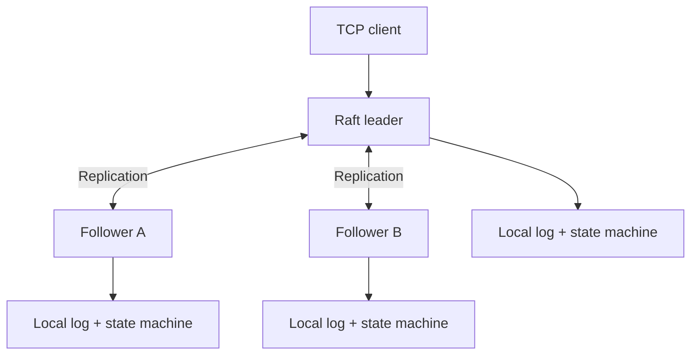

# AtlasKV

### A distributed key-value database built from scratch in C++17

**Raft consensus · Persistent storage · Fault tolerance · Quorum-confirmed reads**

A three-node database that replicates writes, elects leaders, recovers from crashes, and uses fresh quorum confirmation to serve consistent reads.

**11 / 11 final integration tests passed**

[Architecture](#architecture) · [Features](#what-it-does) · [Quick start](#quick-start) · [Testing](#testing) · [Documentation](#documentation)

---

## At a glance

| | |
| :--- | :--- |
| **Language** | C++17 |
| **Cluster** | Three Raft nodes, with leader election and failover |
| **Communication** | Length-prefixed TCP client messages and binary Raft RPCs |
| **Storage** | Durable Raft logs, checksummed records, and an application journal |
| **Consistency** | Majority-committed writes and ReadIndex-style quorum-confirmed GETs |
| **Verification** | 11/11 final integration tests passed |

## What it does

- **Replicates data with Raft.** A leader coordinates log replication, commits entries after majority acknowledgment, and applies committed commands in order.
- **Survives node failures.** The remaining majority can elect a new leader; restarted nodes recover persisted state and rejoin replication.
- **Protects reads against stale leadership.** GET requires a fresh quorum-confirmed read round and waits for the relevant committed entries to be applied.
- **Persists data across restarts.** Durable logs and a separate application journal support recovery and integrity checks.
- **Handles concurrent systems work.** Mutex-protected state and independent peer replication workers coordinate network and storage operations.

## Architecture

Each node stores its own Raft log and key-value state. The leader coordinates writes; a majority of **two out of three nodes** is required for new commits. Followers reject client reads and writes with `NOT_LEADER`.

The repository also preserves an earlier **primary/replica implementation**. Unlike the Raft cluster, that version uses a configured primary rather than elected leadership. [Explore the component architecture →](docs/ARCHITECTURE.md)

## How consistency works

**Writes:** A client sends `put` or `remove` to the leader. The command enters the durable Raft log, is replicated, and becomes committed after majority acknowledgment. The state machine applies it in order before the leader returns the application result.

**Reads:** A leader first commits a current-term no-op entry when elected. For GET, it obtains fresh quorum confirmation, waits until the captured commit index has been applied, then validates leadership and reads under synchronization.

**Failures:** A surviving majority can elect another leader. If a leader loses contact with both followers, it cannot commit new writes or complete fresh quorum-confirmed reads. A timed-out write may still commit later, so the client receives `TIMEOUT UNKNOWN_OUTCOME` rather than a false failure guarantee.

> **Scope:** The integration tests exercise these behaviors, but they are not formal verification or an exhaustive proof of linearizability. The current cluster uses fixed membership and loopback TCP.

## Performance

Historical measurements from the **original TCP/WAL server**, on macOS with localhost clients. These are **not Raft-cluster benchmarks**.

| Operation | Throughput | Avg. latency | P95 latency |
| :--- | ---: | ---: | ---: |
| [GET](benchmarks/results/get_results.txt) | 14,423.92 req/s | 0.07 ms | 0.13 ms |
| [PUT](benchmarks/results/put_results.txt) | 1,887.04 req/s | 0.52 ms | 1.20 ms |
| [REMOVE](benchmarks/results/remove_results.txt) | 2,916.38 req/s | 0.34 ms | 0.62 ms |

These figures come from selected recorded single-client runs of 10,000 successful requests, not a fresh benchmark of the current tree. For methodology, additional client counts, and limitations, see the [benchmark report](docs/BENCHMARK.md).

## Quick start

**Requirements:** macOS, Apple Clang (C++17), Make, system zlib, and Python 3 for tests.

### 1. Build

From the project root, run **`make -j4 apps`**. The compiled programs will be in `build/bin/`.

### 2. Prepare a clean cluster directory

From the project root, run **`mkdir -p build/runtime/raft`** and then **`cd build/runtime/raft`**.

### 3. Start the three nodes

Open three terminals. In **each terminal**, navigate to `build/runtime/raft` and run the corresponding command:

| Terminal | Command | Client port |
| :--- | :--- | :--- |
| **1** | `../../bin/raft_server 1` | `9101` |
| **2** | `../../bin/raft_server 2` | `9102` |
| **3** | `../../bin/raft_server 3` | `9103` |

Raft nodes communicate over RPC ports **9001–9003**. Allow a moment for a leader to be elected.

### 4. Try database commands

Send commands to the **leader** using the length-prefixed TCP protocol (four-byte big-endian message length). Example commands and expected responses on fresh storage:

| Command | Expected response |
| :--- | :--- |
| `put demo hello raft` | `OK` |
| `get demo` | `hello raft` |
| `put demo another` | `KEY_ALREADY_EXISTS` |
| `remove demo` | `OK` |
| `get demo` | `NOT_FOUND` |

For an actual framed TCP client implementation, see [`tests/test_atlaskv_final.py`](tests/test_atlaskv_final.py). The `atlas_client` executable belongs to the **earlier primary/replica server** and does not connect to the Raft ports.

## Testing

From the project root, run **`make test-final`**.

**Final integration suite: 11 passed, 0 failed.** Coverage includes elections, command handling, concurrent writes, quorum-confirmed reads, leader crash and failover, node recovery, loss and restoration of quorum, and full-cluster restart.

The repository also retains historical C++ tests. The full legacy suite is **not green**: four older tests fail to compile against the current interface, and thirteen fail historical expectations. These are documented rather than hidden. See [testing details and known failures](docs/TESTING.md).

## Future improvements

AtlasKV is a systems-engineering project, not a production-ready database. Natural next steps include:

- **Snapshots and log compaction** to bound log growth and reduce recovery work.
- **Dynamic cluster membership** instead of a fixed three-node configuration.
- **Authentication and TLS** for deployment beyond trusted local connections.
- **More rigorous fault injection and concurrency testing**, including network partitions and linearizability checking.
- **Raft-specific benchmarking and profiling** to measure replication and quorum-read overhead directly.

## Repository layout

| Directory | Contents |
| :--- | :--- |
| `src/` and `include/` | C++ implementations and headers |
| `tests/` | Integration and historical tests |
| `benchmarks/` | Benchmark code and recorded results |
| `docs/` | Detailed technical documentation |
| `scripts/` | Test and verification utilities |
| `archive/` | Historical development archives |

## Documentation

[Architecture](docs/ARCHITECTURE.md) · [Replication protocol](docs/REPLICATION.md) · [Benchmarks](docs/BENCHMARK.md) · [Testing](docs/TESTING.md) · [Organization notes](docs/ORGANIZATION.md)
